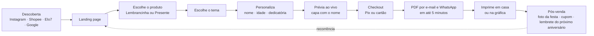

# Meu Livrinho de Colorir: produto, jornada do usuário, LP e marca

**Domínio:** meulivrinhodecolorir.com.br
**Mercado inicial:** Brasil
**Versão:** 1.0 (MVP para o Natal e as festas de fim de ano de 2026)

---

## 1. O produto em uma frase

> **Livrinhos de colorir com o nome da criança, prontos em minutos, para lembrancinha de festa ou presente.**

**Proposta de valor:**
- **Para quem organiza a festa:** lembrancinha linda, barata e pronta na hora. Você recebe o PDF e imprime quantas cópias quiser.
- **Para quem presenteia:** um livrinho em que a criança é a heroína da história, com o nome dela em cada página.
- **Diferenciais:**
  - Personagens e histórias **próprios**, sem cópia de personagem licenciado.
  - **Prévia ao vivo** do nome na capa antes de pagar.
  - **Entrega imediata** por e-mail e WhatsApp.

**O que os dados de busca mostram** (Google Keyword Planner, Brasil, out/2025 a set/2026):

| Busca | Média por mês | Observação |
|---|---|---|
| livro de colorir personalizado / livrinho de colorir personalizado | 1.300 | estável o ano todo; CPC de R$ 0,08 a 1,14 |
| livrinho colorir personalizado (variações) | 320 | |
| livro de colorir personalizado para imprimir | 110 | |
| livro de colorir personalizado para lembrancinha | 90 | |
| kit livrinho de colorir personalizado | 90 | |
| livro personalizado infantil | 1.000 | +116% em relação ao ano anterior |
| presentes personalizados para crianças | 170 | |

---

## 2. Para quem (personas)

### Persona A: Carla, a mãe que organiza a festa (principal)
- 28 a 40 anos, filho ou filha de 2 a 8 anos, organiza a festa sozinha ou com uma amiga.
- Procura lembrancinha no Instagram, na Shopee e no Elo7, de 2 a 6 semanas antes da festa.
- **Dor:** lembrancinha cara, genérica, que chega atrasada ou que usa personagem "pirata".
- **Quer:** algo bonito, com o nome do filho, que as crianças usem de verdade, e com orçamento sob controle.
- **Frequência:** 1 festa por ano por filho, e ainda as festas da escola.

### Persona B: Dona Marta, a avó ou madrinha que presenteia
- 50 a 70 anos, compra pelo celular, quer um presente "com significado".
- **Dor:** não sabe o que dar e não quer mais um brinquedo de plástico.
- **Quer:** facilidade, um resultado emocionante e entrega garantida.
- **Frequência:** aniversário, Natal e Dia das Crianças.

### Persona C: Prof. Juliana, a professora de educação infantil (secundária, fase 2)
- Quer um livrinho da turma, com o nome de cada aluno, para datas comemorativas.
- **Frequência:** várias vezes por ano. É o caminho para recorrência no B2B.

---

## 3. Produtos e preços (hipóteses a testar)

| Produto | O que é | Entrega | Preço de teste |
|---|---|---|---|
| **Lembrancinha PDF** | Livrinho de 8 a 12 páginas, com o nome e a idade da criança na capa e "Festa do(a) ___". Arquivo para imprimir **ilimitado**. | PDF na hora | **R$ 39** (com ancoragem de R$ 59) |
| **Livrinho Presente PDF** | Livrinho de 16 a 20 páginas com **história**, em que a criança é a heroína (nome no texto), com dedicatória. | PDF na hora | **R$ 24,90** |
| **Combo Festa** | Lembrancinha + um Livrinho Presente para o aniversariante | PDF na hora | **R$ 54** |
| *Fase 2: Kit impresso* | 10, 20 ou 30 livrinhos impressos e grampeados, com giz de cera | Correios ou gráfica parceira | a definir |

**Extras opcionais (testar depois):**
- Capa com foto da criança. Fica **fora do MVP**, por causa da LGPD e do trabalho de produção.
- Etiqueta de sacolinha, tag e convite combinando com o tema, de R$ 9 a 15 cada.

---

## 4. Jornada do usuário (MVP)

### 4.1 Visão geral

### 4.2 Passo a passo detalhado

**Passo 1: Descoberta**
- **Canais:**
  - Instagram e Reels: vídeo de criança pintando o livrinho com o próprio nome.
  - Shopee, Elo7 e Mercado Livre: anúncio com link para o site, ou venda direta no próprio marketplace.
  - Google Ads: "livrinho de colorir personalizado".
- **Mensagem-chave:** "Lembrancinha com o nome do seu filho, pronta hoje."

**Passo 2: Landing page** (estrutura na seção 5)
- Em 5 segundos, a pessoa precisa entender: **o que é, quanto custa e como recebe**.
- Botão principal: **"Criar meu livrinho"**.

**Passo 3: Escolha do produto**
- Dois cartões grandes: **🎉 Lembrancinha de festa** e **🎁 Livrinho presente**.
- Cada um mostra o preço, o número de páginas e um "ideal para…".

**Passo 4: Escolha do tema**
- Grade de temas, cada um com capa de exemplo e 2 páginas de amostra (seção 8).
- Filtros simples: "Para meninos e meninas", "Bebês (2 a 3 anos)", "Maiores (5 a 8 anos)". **Nunca** separar por gênero como padrão.

**Passo 5: Personalização** (formulário curto, no máximo 4 campos)
1. **Nome da criança** (obrigatório, até 14 caracteres para caber na capa; avisar quando passar).
2. **Idade que vai fazer** (lista de 1 a 10).
3. **Data da festa** (opcional; serve para o lembrete do ano seguinte).
4. **Dedicatória** (só no Livrinho Presente, até 120 caracteres, com sugestões prontas para clicar).

**Passo 6: Prévia ao vivo** ⭐ (o momento "uau")
- A capa se atualiza **enquanto a pessoa digita o nome**.
- Mostra também 2 páginas internas com o nome aplicado.
- Selo de confiança: "Revisamos cada arquivo antes do envio" e "Garantia: se não gostar, devolvemos o dinheiro".

**Passo 7: Checkout**
- **Pix** (padrão, com desconto de 5%) e **cartão**.
- Pede só **nome, e-mail e WhatsApp**. Sem criar conta.
- Caixa opcional: "Quero receber ideias de festa e cupons".
- Order bump: "Adicione as etiquetas de sacolinha combinando (+R$ 9)".

**Passo 8: Entrega**
- Página de obrigado com o **botão de download** do PDF.
- Mesmo PDF por **e-mail** e **WhatsApp** (link válido por 30 dias).
- O PDF vem em dois arquivos:
  - **Livreto A5** (imposição em A4 para imprimir frente e verso, dobrar e grampear).
  - **Página a página** (para quem imprime em gráfica ou em folhas soltas).
- Guia rápido de impressão em 1 página: papel, configuração da impressora, quantas folhas por livrinho e como montar.

**Passo 9: Pós-venda (crescimento e recorrência)**
- **D+1:** "Deu tudo certo com a impressão?", com link de ajuda.
- **Depois da festa:** "Manda uma foto da criançada pintando? Ganhe 20% no próximo livrinho." Isso gera conteúdo de clientes para o Instagram, com autorização.
- **10 meses depois da data da festa:** "O aniversário do(a) [Nome] está chegando! Quer o livrinho dos [idade+1] anos?" ← **a recorrência anual**.
- **Datas sazonais:** Dia das Crianças, Natal, Páscoa e volta às aulas.
- **Indique e ganhe:** cada convidado da festa leva para casa o livrinho com um QR code discreto na contracapa ("Faça o livrinho do seu filho"). ← **o motor de viralidade**: cada festa expõe a marca a 20 a 40 famílias.

### 4.3 Regras de negócio
- Nome: aceitar acentos e cedilha; bloquear palavrões (lista simples); capitalizar automaticamente ("joão" vira "João").
- Nomes longos: a fonte da capa diminui automaticamente até o mínimo legível; abaixo disso, pedir um apelido.
- O PDF é gerado **na hora**, por script, a partir de artes já prontas. **Nenhuma imagem é gerada por IA durante o pedido.**
- Revisão humana só por amostragem; o envio é automático.
- Reembolso: 7 dias, sem perguntas (exigido pelo CDC para compras online).

### 4.4 Privacidade (LGPD)
- Coletar **só o primeiro nome e a idade** da criança. Sem foto, sobrenome nem escola no MVP.
- Ter política de privacidade clara na LP e no checkout.
- Apagar os dados de personalização em 12 meses, salvo se a pessoa aceitar o lembrete de aniversário.

---

## 5. Landing page: estrutura e textos

**Objetivo único:** clique em "Criar meu livrinho".
**Mobile first:** cerca de 85% do público deve chegar pelo celular (hipótese).

### Seção 1: Hero
- **Título:** Livrinho de colorir com o nome do seu filho.
- **Subtítulo:** Lembrancinha de festa ou presente, pronto em minutos. Você recebe o PDF e imprime quantos quiser.
- **Botão:** `Criar meu livrinho` (+ texto pequeno: "A partir de R$ 24,90 · Pix ou cartão")
- **Visual:** mockup de 3 livrinhos abertos sobre uma mesa de festa, com giz de cera, e uma criança pintando. **Assinatura visual:** metade da ilustração colorida e metade só em contorno, como se estivesse sendo pintada (ver seção 6).
- **Prova rápida:** ⭐ "Mais de X famílias felizes" (entra depois das primeiras vendas).

### Seção 2: Como funciona (3 passos com ícones)
1. **Escolha o tema** 🦕🌊⚽🎄
2. **Digite o nome** e veja a capa na hora
3. **Receba o PDF** e imprima em casa ou na gráfica

### Seção 3: Prévia interativa
- Campo "Digite o nome da criança" já na LP, que atualiza a capa de exemplo ao vivo.
- É a seção que mais converte. Botão: `Gostei! Quero esse`.

### Seção 4: Dois produtos (cartões)
- 🎉 **Lembrancinha de festa:** 12 páginas, nome e idade na capa, imprime ilimitado. **R$ 39**
- 🎁 **Livrinho presente:** 20 páginas com história, a criança é a heroína, com dedicatória. **R$ 24,90**
- 💛 **Combo festa:** os dois por **R$ 54**

### Seção 5: Galeria de temas
- Carrossel com as capas. Cada uma abre as páginas de amostra.

### Seção 6: Por que é diferente
- ✏️ **Desenhos com traço grosso**, fáceis de pintar até para os pequenos.
- 📖 **Tem história de verdade**, não só desenhos soltos.
- 🎨 **Personagens próprios**, sem cópia de personagem famoso.
- ⚡ **Pronto em minutos**, nada de esperar os Correios.
- 🖨️ **Imprima quantas vezes quiser**, para todos os convidados.

### Seção 7: Fotos de clientes (entra depois das primeiras vendas)
- Fotos reais de festas e de crianças pintando, com depoimentos curtos.

### Seção 8: Perguntas frequentes
- Como imprimo? Que papel uso?
- Posso imprimir quantas cópias quiser? *(Sim, para uso pessoal e na sua festa.)*
- Em quanto tempo recebo?
- Posso mudar o nome depois? *(Sim, uma correção grátis em até 48 h.)*
- Vocês enviam impresso? *(Em breve.)*
- Para que idade é indicado?
- E se eu não gostar? *(Devolvemos o dinheiro em até 7 dias.)*

### Seção 9: Chamada final
- **Título:** A festa vai ficar com a cara do seu filho.
- **Botão:** `Criar meu livrinho agora`

### Rodapé
- CNPJ, contato por WhatsApp, política de privacidade, termos de uso e trocas.

### SEO da LP
- **Title:** Livrinho de Colorir Personalizado com Nome | Lembrancinha e Presente
- **Meta description:** Livrinho de colorir com o nome da criança. Lembrancinha de festa infantil ou presente, pronto em minutos para imprimir. Temas exclusivos.
- **H1:** Livrinho de colorir personalizado com o nome do seu filho
- **Palavras para usar no texto:** livro de colorir personalizado · livrinho para colorir personalizado · lembrancinha livro de colorir · livro infantil personalizado · livro com nome da criança · presente personalizado infantil · para imprimir.

---

## 6. Marca: conceito, cores e linguagem visual

### 6.1 Conceito: "Do contorno à cor"
A marca vive no momento em que o desenho ganha cor pela mão da criança.
- **Assinatura visual:** ilustrações e elementos da página aparecem **parte em contorno preto e parte colorida**, com uma borda de "rabisco de giz de cera" onde a cor termina, como um desenho sendo pintado.
- Remete ao produto (o livrinho começa em preto e branco e a criança dá a cor) e diferencia a marca da concorrência, que usa mockups genéricos e cores neon.

### 6.2 Personalidade
- **Acolhedora:** fala com mãe e avó como uma amiga que ajuda na festa.
- **Brincalhona, sem ser boba:** humor leve e trocadilhos com cor ("Hoje tem festa colorida").
- **Confiável:** clara sobre preço, prazo e impressão.
- **Tom de voz:**
  - "Você recebe na hora" em vez de "Entrega instantânea garantida".
  - "Seu filho", "sua filha", "a criançada".
  - Evitar jargão ("PDF de alta resolução" vira "arquivo prontinho para imprimir").

### 6.3 Paleta de cores (inspirada em caixa de giz de cera)

| Papel | Nome | HEX | Uso |
|---|---|---|---|
| Fundo | **Papel** | `#FFF8EE` | fundo principal (creme quente, como papel) |
| Texto | **Grafite** | `#2B2D42` | títulos, textos, contornos das ilustrações |
| Primária | **Laranja Giz** | `#FF8A3D` | botões principais (com texto em Grafite), destaques |
| Secundária | **Azul Céu** | `#4FB3E8` | links, ícones, seções alternadas |
| Apoio | **Amarelo Sol** | `#FFD23F` | selos, estrelas, preço em destaque |
| Apoio | **Verde Folha** | `#6CC26A` | confirmação, "pronto!", temas de natureza |
| Apoio | **Rosa Chiclete** | `#FF7EB6` | detalhes, ilustrações, temas de festa |
| Neutro | **Nuvem** | `#F1EDE6` | cartões, divisórias |

**Regras de contraste e uso:**
- O botão principal é **Laranja Giz com texto em Grafite** (contraste alto). Não use texto branco sobre laranja ou amarelo, porque não passa no teste de acessibilidade.
- Texto corrido sempre em Grafite sobre Papel ou branco.
- Use **no máximo 2 cores de apoio por seção**, para não virar "arco-íris".
- O fundo nunca é branco puro: o creme deixa tudo mais acolhedor e combina com a ideia de papel.

> **Atualização de 18/10/2026:** a identidade visual completa (direção Ateliê de Rabiscos, mascote Rabisco, tipografia Baloo 2 + Nunito Sans) está em `docs/identidade-visual.md` e vale por cima desta seção 6 onde as duas divergirem.

### 6.4 Tipografia (Google Fonts, gratuitas)
- **Títulos:** **Baloo 2** (ExtraBold), arredondada, amigável e muito legível no celular.
- **Textos:** **Nunito** (Regular, SemiBold e Bold). É a mesma família usada nas capas Little Paws, o que dá coerência entre as marcas.
- **Detalhes manuscritos** (no máximo 3 palavras por vez, como "pronto em minutos!"): **Gochi Hand** ou **Patrick Hand**.

### 6.5 Logo (briefing)
- **Logotipo:** "meu livrinho de colorir" em Baloo 2, em minúsculas, em duas linhas:
  - `meu livrinho`
  - `de colorir` (menor)
- **Símbolo:** um livrinho aberto cujas páginas viram um **arco-íris de giz de cera**, ou um giz de cera desenhando um coração. Contorno grosso Grafite, com preenchimento parcial (a assinatura "do contorno à cor").
- **Versões:** horizontal, empilhada e símbolo sozinho (para o avatar do Instagram).
- **Cores:** contorno Grafite; preenchimentos Laranja, Azul e Amarelo.

### 6.6 Elementos gráficos
- Rabiscos de giz de cera: sublinhados, círculos em volta de palavras, setinhas desenhadas à mão.
- Estrelinhas, coraçõezinhos e pontinhos de confete nas cores de apoio.
- Cartões com cantos bem arredondados (16 a 24 px) e sombra suave.
- Botões arredondados em pílula, com uma linha de contorno Grafite de 2 px (lembra o traço do livrinho).
- Fotos sempre em ambiente real: mesa de festa, criança pintando, mãos com giz de cera. Luz natural e quente.

### 6.7 O que evitar
- Cores neon e degradês fortes.
- Personagens licenciados ou parecidos com eles (Disney, Bobbie Goods, Turma da Mônica, Bluey…).
- Separar por gênero ("meninos azul / meninas rosa") como padrão.
- Excesso de texto no hero.
- Mockups 3D genéricos de banco de imagens.

### 6.8 Referências no Behance (para navegar)
O Behance bloqueia a leitura automática dos projetos, então estas são as buscas mais úteis para você abrir e salvar referências num moodboard:
- [Kids branding](https://www.behance.net/search/projects/kids%20branding)
- [Marca infantil](https://www.behance.net/search/projects/marca%20infantil)
- [Kids landing page](https://www.behance.net/search/projects/kids%20landing%20page?locale=en_US)
- [Coloring book](https://www.behance.net/search/projects/coloring%20book)
- [Kids colouring book](https://www.behance.net/search/projects/kids%20colouring%20book)
- [Loja infantil](https://www.behance.net/search/projects/loja%20infantil)
- [Ilustração infantil](https://www.behance.net/search/projects/ilustra%C3%A7%C3%A3o%20infantil)
- [Playful](https://www.behance.net/search/projects/%20playful?locale=en_US)

**O que procurar nas referências:** paletas "giz de cera" sobre fundo creme, tipografia arredondada, ilustração com contorno grosso, elementos desenhados à mão e mockups de produto em ambiente real.

---

## 7. Especificação do livrinho (arquivo PDF)

### Lembrancinha (12 páginas)
- **Formato final:** A5 (14,8 × 21 cm), retrato.
- **Imposição para imprimir em casa:** 3 folhas A4, frente e verso, dobrar ao meio e grampear (2 grampos).
- **Estrutura:**
  1. Capa: "Festa do(a) **[Nome]** · **[idade]** anos" + ilustração do tema.
  2. "Este livrinho é de: ______" + "Obrigado por vir à minha festa! 💛"
  3. a 11. Nove desenhos para colorir do tema, com uma frase curta em cada um.
  4. Contracapa: "Feito com carinho por meulivrinhodecolorir.com.br" + QR code discreto.
- **Página a página:** os mesmos desenhos em A4 cheio, para a família imprimir em gráfica ou em folhas soltas.

### Livrinho Presente (20 páginas)
- **Formato:** A5 ou A4 (a cliente escolhe na hora do download).
- **Estrutura:** capa com o nome, dedicatória, 16 páginas de história com o **nome da criança no texto** ("Naquela manhã, **Laura** acordou com um barulhinho…"), página "Desenhe você aqui!" e contracapa.

### Regras de arte (as mesmas dos livros Little Paws)
- Contorno preto grosso, fundo branco, sem cinza nem sombra.
- Formas grandes e fáceis de pintar: **traço extra grosso nas versões de 2 a 4 anos**.
- Espaço reservado e branco para o nome e as frases, aplicados por script.

---

## 8. Temas do MVP e calendário

### MVP (lançar até meados de novembro)
1. **Futebol com a turma Little Paws** ⚽ (já temos personagens e estilo).
2. **Natal mágico** 🎄 (pico de dezembro).
3. **Fundo do mar** 🌊 (tema neutro e muito usado em festas).

### Fase 2 (janeiro a março)
4. Dinossauros 🦕
5. Safári e selva 🦁
6. Fazendinha 🐄
7. Espaço e astronauta 🚀
8. Unicórnio e arco-íris 🦄
9. Fadas e jardim encantado 🧚
10. Confeitaria e docinhos 🧁

### Calendário de datas
| Período | Ação |
|---|---|
| Out a Dez | Natal + festas de fim de ano |
| Jan a Fev | Volta às aulas ("Meu primeiro dia") |
| Mar a Abr | Páscoa |
| Jun a Jul | Festa junina |
| Out | Dia das Crianças |
| O ano todo | Aniversários (lembrancinha) |

---

## 9. MVP técnico (sugestão)

| Parte | Ferramenta | Observação |
|---|---|---|
| LP + fluxo de personalização | Next.js (ou Framer/Webflow para validar mais rápido) | Prévia ao vivo com a capa em SVG + campo de nome |
| Pagamento | Mercado Pago ou Stripe (Pix + cartão) | Webhook confirma o pagamento |
| Geração do PDF | Script Python (já usado nos livros) chamado por uma função | Recebe tema, nome, idade e dedicatória; devolve o PDF em segundos |
| Pedidos e clientes | Supabase | Tabela de pedidos, temas e lembretes |
| Automação | n8n | Envio por e-mail e WhatsApp, lembretes D+1, pós-festa e aniversário |
| Armazenamento | Supabase Storage | Link de download válido por 30 dias |
| Analytics | GA4 + Meta Pixel | Eventos: início de personalização, prévia vista, checkout, compra |

**Ainda mais simples (para validar em 1 semana):** LP + formulário + link de pagamento. Eu gero o PDF manualmente por script e você envia pelo WhatsApp. Só automatizar depois das primeiras 20 vendas.

---

## 10. Metas do teste (até 31/12/2026)

| Métrica | Meta |
|---|---|
| Visitas à LP | 2.000 |
| Taxa de início de personalização | ≥ 25% |
| Conversão visita → compra | ≥ 2% |
| Pedidos | **≥ 40** |
| Ticket médio | ≥ R$ 35 |
| Custo por venda (anúncios) | ≤ R$ 15 |
| Pedidos vindos de QR code ou indicação | ≥ 10% |

**Critério de decisão:** batendo 40 pedidos com custo por venda abaixo de R$ 15, vale investir no app e no kit impresso. Abaixo de 15 pedidos, revisar a oferta (preço, temas e canal) antes de investir mais.
