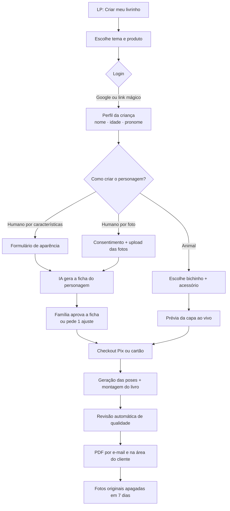

# Meu Livrinho de Colorir — Especificação da personalização
## A criança vira personagem da história (humano ou animal)

**Versão:** 1.0 · **Status:** proposta para desenvolvimento
**Base:** `meulivrinhodecolorir-produto-e-marca.md` (jornada, LP, marca) e a biblioteca `livros-md/` (modelos de história, fichas e prompts).

---

## 1. Visão geral

A família cria o **personagem da criança** e ele entra na história como o novo membro do time.

| Opção | Como a família cria | Como o personagem é feito | Custo por pedido |
|---|---|---|---|
| **A. Animal** | Escolhe o bichinho, o acessório e o nome | **Biblioteca pronta** (poses desenhadas antes, sem IA no pedido) | ~zero |
| **B. Humano por características** | Preenche um formulário (cabelo, pele, óculos…) | **IA gera o personagem** a partir da descrição | baixo |
| **C. Humano por foto** | Envia 1 foto do rosto + 1 de corpo inteiro (opcional) | **IA transforma a foto** em personagem desenhado | médio |

**Regra de ouro (para as três opções):** a IA gera **só o personagem** (ficha + poses). As cenas da história são **fixas e já aprovadas**, e o código encaixa o personagem nelas. Isso garante:
- qualidade igual em todos os livros (as cenas já foram revisadas);
- o personagem igual em todas as páginas (as poses saem da mesma ficha);
- custo e tempo previsíveis (são cerca de 9 imagens por pedido, e não 20 páginas inteiras).

---

## 2. Jornada do usuário



**Por que o login entra antes da personalização:** as fotos e o personagem ficam ligados a uma conta. Isso permite:
- excluir os dados quando a família quiser;
- recomprar com o mesmo personagem (outro tema, próximo aniversário);
- mandar o lembrete do aniversário seguinte.

**Ordem do pagamento:** na opção A, a família paga e recebe na hora. Nas opções B e C, a família **vê e aprova a ficha do personagem antes de pagar**. A ficha custa centavos para gerar e é o que convence a comprar.

---

## 3. Login e conta

- **Supabase Auth:** login com Google e **link mágico por e-mail** (sem senha para esquecer). Opcional: e-mail e senha.
- **Área do cliente "Meus livrinhos":**
  - crianças cadastradas (nome, idade, pronome);
  - personagens salvos;
  - pedidos e downloads;
  - botões **"Apagar fotos agora"** e **"Excluir minha conta e todos os dados"**.
- A conta é do **adulto responsável**. A criança nunca tem login.

---

## 4. Opção A — Personagem animal

**Campos:**
- Bichinho: gatinho, cachorrinho, panda ou elefantinho (MVP). Nenhum repete os animais do time.
- Acessório: boné, laço, óculos ou coroa.
- Cor favorita: usada só na capa colorida (suéter ou camiseta).

**Produção (uma vez só):**
- **Ficha + 8 poses** por animal: de pé acenando, correndo, sentado, segurando algo, pulando, apontando de costas, comemorando e retrato da capa.
- Acessórios como camadas separadas, posicionadas na cabeça de cada pose.
- Versão em **contorno preto** (miolo) e versão **colorida** (capa), com a cor do suéter trocada por código.

---

## 5. Opção B — Humano por características

**Formulário (tudo por botões com desenhos, sem texto livre):**

| Campo | Opções |
|---|---|
| Idade | 2 a 10 (define as proporções do corpo) |
| Altura para a idade | mais baixinho(a) · na média · mais alto(a) |
| Tom de pele | 8 tons (usado só na capa colorida; no miolo a criança pinta) |
| Tipo de cabelo | liso · ondulado · cacheado · crespo · raspado/bem curto |
| Comprimento | curto · médio · longo |
| Penteado | solto · rabo de cavalo · maria-chiquinha · trança · coque · black power |
| Cor do cabelo | preto · castanho escuro · castanho claro · loiro · ruivo |
| Óculos | não · redondos · retangulares |
| Detalhes (opcional) | sardas · covinhas · aparelho nos dentes · aparelho auditivo · cadeira de rodas* |
| Roupa favorita | camiseta e bermuda · vestido · macacão · camiseta do time |
| Cor favorita | 8 cores (capa colorida) |

\* **Cadeira de rodas e aparelho auditivo** entram desde o início, mas exigem cenas compatíveis. As poses de cadeira de rodas precisam de cenas base próprias (sem escada, correndo vira "andando rápido"). Recomendo lançar na fase 2, com cuidado e testes com famílias.

**Como vira personagem:** o sistema monta um **prompt estruturado** a partir das escolhas (seção 7) e gera a ficha do personagem.

---

## 6. Opção C — Humano por foto

### 6.1 O que a família envia
- **Foto 1 (obrigatória):** rosto de frente, bem iluminado, sem óculos escuros, sem filtro.
- **Foto 2 (opcional):** corpo inteiro, de pé, para ajudar nas proporções.
- Formatos JPG, PNG ou HEIC, até 10 MB.
- A tela de upload mostra exemplos de foto boa e foto ruim.

### 6.2 Consentimento (obrigatório antes do upload)
Checkbox não pré-marcado, com texto claro:
> Sou mãe, pai ou responsável legal por esta criança e autorizo o uso destas fotos **apenas** para criar o personagem desenhado do livro. As fotos originais serão **apagadas automaticamente em 7 dias**. O personagem desenhado fica salvo na minha conta até eu excluir.

Registrar no banco: **data/hora, versão do texto aceito e ID do usuário.**

### 6.3 Regras de privacidade e segurança
- **Bucket privado** no Supabase Storage. Acesso só por URL assinada de curta duração, nunca pública.
- **Exclusão automática em 7 dias:** um job diário (pg_cron ou n8n) apaga os arquivos do bucket e registra a exclusão.
- **Botão "Apagar fotos agora"** na área do cliente.
- Remover os **metadados EXIF** (GPS, data, aparelho) logo no upload.
- **O personagem desenhado também é dado pessoal** (deriva do rosto da criança): fica salvo na conta e é apagado quando a família excluir o personagem ou a conta.
- Os PDFs entregues ficam disponíveis por 30 dias e depois são apagados (a família já baixou).
- Equipe interna **não vê fotos** por padrão. Acesso só em caso de suporte pedido pela família, com registro.

### 6.4 ⚠️ Pontos a validar antes de construir (hipóteses, não confirmados)
1. **Política do provedor de IA para fotos de crianças reais.** As políticas de uso de imagem da OpenAI (e de outros provedores) têm regras específicas para edição de imagens de pessoas reais e de menores, e a moderação pode recusar fotos de crianças. **Testar com o modelo e ler a política vigente** antes de prometer a opção C. Ter sempre a opção B como alternativa automática quando a foto for recusada.
2. **Retenção de dados no provedor.** Verificar quanto tempo o provedor guarda as imagens enviadas pela API e se há opção de retenção zero. Isso precisa constar na política de privacidade.
3. **LGPD (art. 14, dados de crianças):** exige consentimento específico e em destaque de pelo menos um dos pais ou responsável, e uso só para a finalidade informada. Recomendo revisão de um advogado antes de lançar a opção C.
4. **Qualidade:** testar com 20 a 30 fotos reais (de família e amigos, com autorização) para medir semelhança, consistência entre poses e taxa de recusa.

---

## 7. Geração do personagem (opções B e C)

### 7.1 Etapas
1. **Ficha do personagem (colorida + contorno):** frente e três-quartos, no estilo Little Paws (contorno grosso, formas arredondadas, proporções infantis).
2. **Aprovação da família:** "Ficou parecido?" → aprovar ou pedir **1 ajuste guiado** (cabelo mais longo, sem óculos…). Ajustes extras são pagos ou pedem nova geração.
3. **8 poses** geradas usando a ficha aprovada como referência (as mesmas poses da opção A).
4. **Limpeza automática:**
   - remover o fundo;
   - converter para preto puro;
   - engrossar levemente as linhas;
   - recortar com margem.
5. **Checagem de qualidade automática:**
   - há cinza ou preenchimento preto grande?
   - o fundo está branco?
   - a figura está inteira e dentro das proporções esperadas?

   Se falhar, gera de novo (até 2 vezes) e depois manda para revisão manual.

### 7.2 Prompt-base da ficha (modelo)
```
Create ONE character reference sheet of a child character for a children's coloring book, in the established "Little Paws" style: soft rounded cartoon proportions for a {AGE}-year-old child ({HEIGHT} for their age), clean thick black outlines, friendly expression.
Appearance: {HAIR_TYPE}, {HAIR_LENGTH} hair styled as {HAIRSTYLE}; {GLASSES}; {DETAILS}; wearing {OUTFIT}.
[Only for photo option:] Use the attached photo ONLY as a loose reference for hairstyle, face shape and general features, turning the child into a simple, stylized cartoon character. Do not copy the photo realistically.
Show the character twice: front view and three-quarter view, standing, full body, on a plain white background.
Version 1: full color (skin {SKIN_TONE}, hair {HAIR_COLOR}, outfit in {FAVORITE_COLOR}).
Version 2: black outlines only, every area white, no gray, no shading.
No text, no labels.
```

### 7.3 Prompt-base das poses
```
Using the approved character sheet as the exact reference, draw the SAME child character in pose: {POSE_DESCRIPTION}. Black-and-white coloring-book line art, thick clean black outlines, every area white, no gray, no shading, no background, plain white. Full body, centered, nothing cropped. No text.
```

**Custo estimado por pedido (hipótese a medir):** 1 a 2 fichas + 8 poses ≈ 10 imagens. Calcular com o preço atual da API escolhida antes de definir o preço de venda.

---

## 8. Como o personagem entra na história

### 8.1 Modelo de história com vagas
Cada tema tem um modelo (JSON) com as páginas fixas e as vagas do personagem:

```json
{
  "template_id": "time-little-paws-aniversario-v1",
  "language": "pt-BR",
  "pages": [
    {
      "page": 3,
      "base_image": "cenas/aniversario/p03.png",
      "slot": { "pose": "acenando", "x": 0.62, "y": 0.48, "height": 0.34, "flip": false },
      "front_layer": null,
      "text": "Naquela manhã, {NOME} chegou ao parque e viu o time da Little Paws jogando bola."
    },
    {
      "page": 10,
      "base_image": "cenas/aniversario/p10-{SUPERPODER}.png",
      "slot": { "pose": "{POSE_SUPERPODER}", "x": 0.40, "y": 0.52, "height": 0.36 },
      "text_by_superpoder": {
        "corajoso": "{NOME} respirou fundo e subiu na pedra para alcançar a bola.",
        "criativo": "{NOME} teve uma ideia: usar o cachecol da Luna como corda!",
        "gentil": "{NOME} sentou ao lado do Pip e disse: \"Vamos tentar juntos?\""
      }
    }
  ]
}
```

- **`slot`:** posição e altura relativas à página. A altura segue a idade (crianças mais velhas um pouco maiores) e a altura escolhida no formulário.
- **`front_layer`:** quando algo precisa ficar **na frente** do personagem (uma mesa, a cerca), a cena tem uma camada extra que é desenhada por cima.
- **Cenas base:** desenhadas com um espaço livre onde o personagem entra. Nunca há contato físico direto com outro personagem (mãos dadas, abraço), porque isso não encaixa bem.

### 8.2 Texto
- **Variáveis:**
  - `{NOME}`, `{IDADE}`;
  - pronome (`{ELE_ELA}`, `{O_A}`, `{DELE_DELA}`), com a opção "usar só o nome";
  - `{ANIMAL}` (opção A), `{SUPERPODER}` e `{COR}`.
- O texto é revisado para funcionar **com qualquer nome** (sem rima que dependa do nome, sem trocadilho).
- **Idioma:** pt-BR no lançamento. O modelo já guarda `language` para a versão em inglês.

### 8.3 Montagem
O script Python dos livros recebe o modelo, as poses e as variáveis e gera:
- **Lembrancinha:** PDF A5 em livreto (imposição A4) + página a página.
- **Presente:** PDF A4.

---

## 9. Modelo de dados (Supabase)

| Tabela | Campos principais |
|---|---|
| `profiles` | id (auth), nome do responsável, e-mail, WhatsApp, aceite de marketing |
| `children` | id, profile_id, primeiro nome, idade, pronome, data do aniversário (opcional) |
| `characters` | id, child_id, tipo (`animal` / `humano_form` / `humano_foto`), atributos (JSON), status (`rascunho`, `ficha_gerada`, `aprovado`, `poses_prontas`), ficha_url, criado_em |
| `character_poses` | id, character_id, pose, url_contorno, url_colorida |
| `photo_uploads` | id, character_id, storage_path, enviado_em, **apagar_em (= +7 dias)**, apagado_em |
| `consents` | id, profile_id, tipo (`foto_crianca`, `marketing`), versão do texto, aceito_em, IP |
| `templates` | id, tema, idioma, versão, JSON do modelo |
| `orders` | id, profile_id, character_id, template_id, produto, valor, status, pagamento_id |
| `books` | id, order_id, pdf_url, gerado_em, expira_em |
| `generation_jobs` | id, character_id, etapa, tentativas, custo, erro, status |

**Row Level Security** em todas as tabelas: cada responsável só vê os próprios dados.

---

## 10. Arquitetura sugerida

| Parte | Ferramenta |
|---|---|
| Site, LP e área do cliente | Next.js na Vercel (já existe: meulivrinhodecolorir.vercel.app) |
| Login, banco, arquivos | Supabase (Auth, Postgres, Storage privado) |
| Pagamento | Mercado Pago ou Stripe (Pix + cartão), com webhook confirmando o pedido |
| Fila de geração | Tabela `generation_jobs` + worker |
| Geração de imagem | API de imagem (OpenAI ou equivalente), chamada pelo worker |
| Limpeza das imagens e montagem do PDF | Worker Python (o mesmo código dos livros), num serviço com tempo de execução longo (as funções da Vercel têm limite de tempo) |
| Automação | n8n: e-mails, WhatsApp, lembretes, exclusão das fotos em 7 dias |
| Monitoramento | Log de cada etapa + alerta quando um job falhar 2 vezes |

---

## 11. Preços (hipóteses para testar)

| Produto | Animal | Humano por características | Humano por foto |
|---|---|---|---|
| Lembrancinha PDF | R$ 39 | R$ 49 | R$ 59 |
| Livrinho Presente PDF | R$ 24,90 | R$ 34,90 | R$ 44,90 |
| Personagem extra no mesmo pedido (irmão) | +R$ 15 | +R$ 19 | +R$ 25 |
| Novo tema com personagem já salvo | R$ 19,90 | R$ 19,90 | R$ 19,90 |

**Recompra é o grande diferencial:** o personagem fica salvo, então o próximo livro (outro tema, próximo aniversário, Natal) sai **sem gerar nada de novo**, com custo quase zero e preço menor.

---

## 12. Fases de lançamento

1. **Fase 1 (MVP):** opção A (animal) + 1 tema, sem login obrigatório (só e-mail no checkout). Valida a demanda.
2. **Fase 2:** login + opção B (humano por características) + área do cliente + recompra.
3. **Fase 3:** opção C (foto), **só depois** de validar a política do provedor de IA, a revisão jurídica e o teste de qualidade com 20 a 30 fotos.
4. **Fase 4:** mais temas, irmãos no mesmo livro, versão em inglês e livro impresso.

---

## 13. Métricas

| Métrica | Para quê |
|---|---|
| % que escolhe animal × humano × foto | Onde investir em mais opções |
| Taxa de aprovação da ficha na 1ª tentativa | Qualidade da geração |
| Taxa de recusa da foto pela moderação | Viabilidade da opção C |
| Custo de IA por pedido | Margem |
| Tempo do pagamento até o PDF | Experiência (meta: menos de 10 min) |
| Recompra em 12 meses | Valor do personagem salvo |
